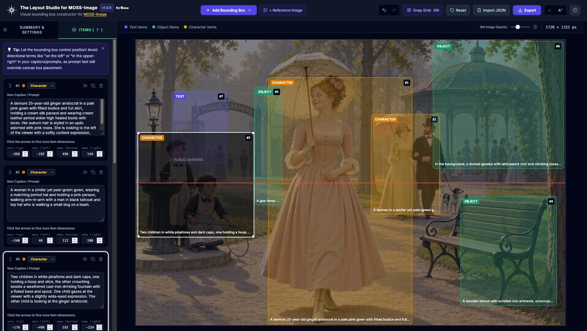
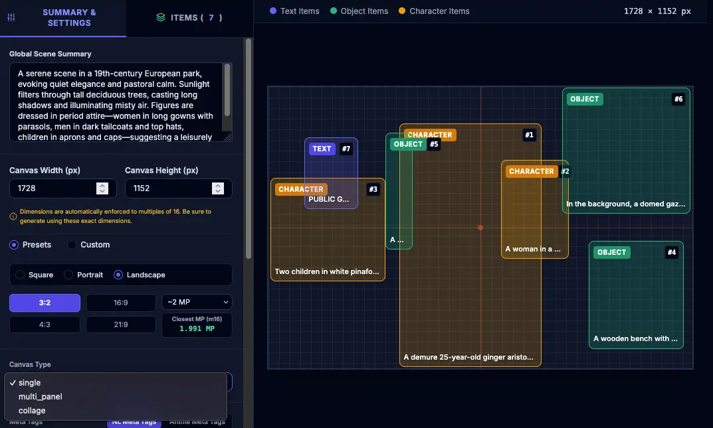
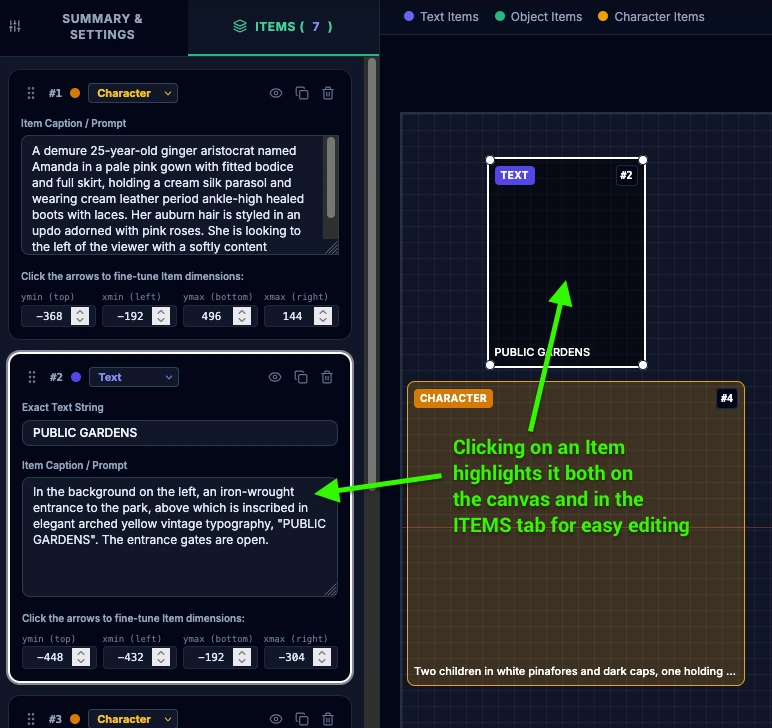
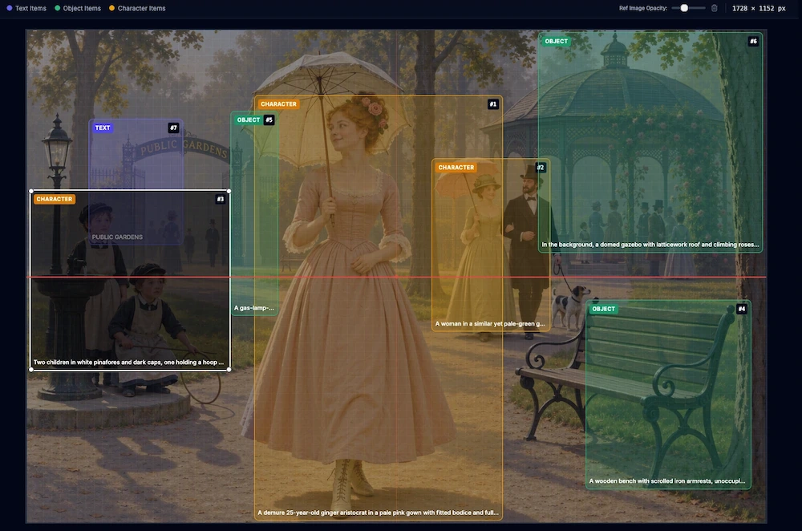
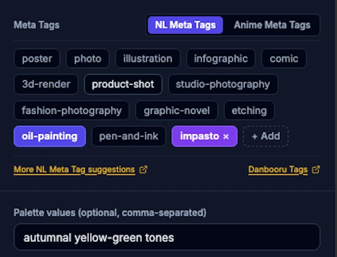
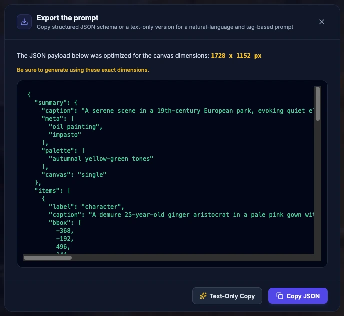
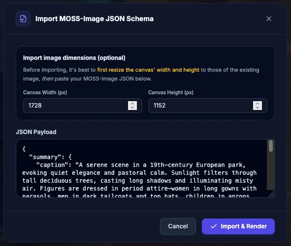
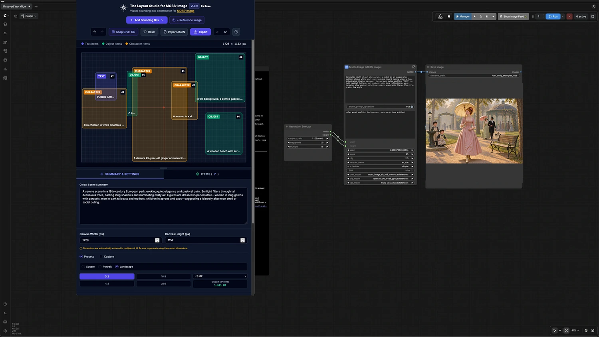

# The Layout Studio for MOSS-Image

Take the guesswork out of creating bounding-box layouts for [MOSS-Image](https://github.com/OpenMOSS/MOSS-Image/tree/main) with this free, open-source, browser-based, cross-platform, locally hosted (and therefore *private!*) visual spatial-precision layout editor designed specifically to generate reliable JSON bbox prompts for MOSS-Image for use with any AI-image generator.

<p align="center">
  <br>
  <em>The Layout Studio for MOSS-Image</em>
</p>

### 🚀 **[Launch the Live Web Demo](https://your-username.github.io/your-repo/your-file.html)**
*(No installation required — runs directly in your browser. Prefer offline use? Download the latest release from the [Releases](../../releases/latest) page.)*

---

## Table of Contents
- [Overview](#overview)
- [Who needs a layout builder for MOSS-Image?](#who-needs-a-layout-builder-for-moss-image)
- [Main Features](#main-features)
  - [Dynamic Canvas](#-dynamic-canvas)
  - [Item Management](#%EF%B8%8F-item-management)
  - [Reference Background Image](#%EF%B8%8F-reference-background-image)
  - [Meta Tags & Palette Management](#%EF%B8%8F-meta-tags--palette-management)
  - [Danbooru & Anime Compatible](#-danbooru--anime-compatible)
  - [Multi-Format Exporting](#%EF%B8%8F-multi-format-exporting)
  - [JSON Import with Smart Dimension Matching](#%EF%B8%8F-json-import-with-smart-dimension-matching)
  - [Responsive Design](#-responsive-design)
  - [Lightweight, Fast, and 100% Private](#-lightweight-fast-and-100-private)
  - [Additional Features](#additional-features-include)
- [Caveats & Hints](#caveats--hints)
- [Getting Started](#getting-started)
- [File Structure](#file-structure)
- [License](#license)
- [About MOSS-Image](#about-moss-image)
- [Tips are welcome](#tips-are-welcome)
- [Changelog](#changelog)


---
## Overview

If, like me, you've been intrigued by the use of "bounding boxes" (or "bboxes" for short) to lay out complex compositions with better accuracy, you've encountered the same obstacles as I had:

- Crafting JSON prompts by hand is a non-starter.
- Even state-of-the-art LLMs like GPT-4o have a hard time converting natural-language or tag-based prompts into sub-pixel *yxyx* coordinate space (`-500` to `500` centered) JSON prompts.
- There are some workflows for ComfyUI that provide visual layout design, but not everyone uses Comfy, and even if they do, it's not the most design-friendly interface.

**The Layout Studio for MOSS-Image** fixes all that.

**Use the Studio to lay out what you want where, export the JSON prompt, and drop it in any AI-image generator running MOSS-Image** — ComfyUI, Forge Neo, Civitai Online Generator, Tensor.art, Yodayo/Moescape, SeaArt...take your pick! If it's got a prompt box and it's running MOSS-Image, you're good to go.

Designed as a lightweight, zero-dependency tool, it operates 100% locally, ***privately***, and offline — on any modern web browser, on any OS — without requiring ComfyUI, Python, build steps, servers, or external network requests.

---

## Who needs a layout builder for MOSS-Image?

- <ins>**Fans of MOSS-Image:**</ins> Love MOSS-Image and want to take your gens to the next level by mastering its native spatial precision via bbox coordinates, but without all the trail-and-error when using LLMs and without using a specialized Comfy workflow? Build your images visually on a drag-and-drop canvas while the Studio handles all schema math automatically. Then drop the prompt in your favorite generator.

- <ins>**Multi-Character & Anime Creators:**</ins> Sick of so-called 'concept bleed' (mixing of traits, outfits, etc.) in multi-subject scenes? The bounding-box features of new models like Ideogram 4 and MOSS-Image is the next-gen equivalent of [regional prompting](https://stable-diffusion-art.com/regional-prompter/), and may be adopted by future models, as well. Use the Layout Studio to keep those characters separated, then copy & paste the prompt into a generator running MOSS-Image.

- <ins>**Visual Designers & Typographers:**</ins> Need text placed where it belongs? Position headers, typography, and logos with greater visual accuracy for posters, album covers, and banners.

- <ins>**Product & E-Commerce Visual Creators:**</ins> Structure studio product shots, hero element placements, and advertising layouts while locking canvas aspect ratios and target megapixel presets (`~1 MP` to `~4 MP`).

- <ins>**Storyboard & Comic Artists:**</ins> Easily block out multi-panel sequence compositions and background layouts using native `multi_panel` and `collage` canvas modes.

- <ins>**Cross-Model Power Users:**</ins> Compose layouts visually over local reference images, then export to structured MOSS-Image JSON schemas, or to text-only prompts for refining with img2img or inpainting with a natural-language model like Krea 2 or a tag-based model like Illustrious, or any other model in your stack for that matter.

---

## Main Features

### 🎨 Dynamic Canvas
<p align="center">
  <br>
</p>

- Automatically scales to fit any display or window size while maintaining target aspect ratios (`1:1`, `2:3`, `3:4`, `9:16`, `9:21`, `3:2`, `4:3`, `16:9`, `21:9`) and target megapixel values (`~1 MP` to `~4 MP`).
- Workspace dimensions dynamically adapt on the fly without clipping or off-screen overflow.
- The built-in visual grid, with optional grid snapping, aligns directly to MOSS-Image's requirement that canvas and bounding box dimensions follow 16-pixel multiples.
- Visual alignment crosshairs automatically highlight when an item's center point aligns horizontally or vertically with the center of the image.

---

### ⬆️ Item Management
<p align="center">
  <br>
</p>

- Create scene elements with MOSS-native `text`, `object`, or `character` item types using color-coded boxes and corresponding "cards" that you can reorder with drag-and-drop in the Items tab. This also reorders the items in the exported output.
- Drag, resize, and nudge bounding boxes visually on a canvas mapped directly to MOSS-Image's standardized centralized coordinate space (`abs_centralized`, `yxyx` format from `-500` to `500`).
- Toggle individual bounding boxes on or off to preview layout variations or temporarily exclude specific elements from schema generation without deleting card data.
- Switch seamlessly between overall scene settings and bounding-box management in one minimal strip.
- Intelligent auto-focus opens item details immediately when interacting with bounding boxes on the canvas.

---

### 🖼️ Reference Background Image
<p align="center">
  <br>
</p>

- Insert a reference image locally — and privately! — "under" the canvas, with adjustable opacity to visually align bounding boxes directly over an existing composition.

---

### 🏷️ Meta Tags & Palette Management
<p align="center">
  <br>
</p>

- Add preset or custom style meta tags and hex or named color palettes to set global scene styling.

  ⚠️ **Note:** Meta Tag and Palette values are overridden by any competing value in the prompt text. Describing media, styles, colors, and other details directly in the prompt text will often have a stronger impact on the image output than Meta Tags or Palette values.

---

### 🦋 Danbooru & Anime Compatible

- Use the dual-tabbed Meta Tag manager, featuring natural-language style tags alongside anime/Danbooru preset tags (`cel shading`, `masterpiece`, `cowboy shot`, etc.).
- Supports parenthesis weighting syntax `(tag:1.2)`
- In-app link to Safebooru tag search.

---

### ↘️ Multi-Format Exporting
<p align="center">
  <br>
</p>

- Instantly generate and copy a MOSS-Image central-coordinate JSON schema, OR:
- A text-only prompt in natural language or tag-based format, depending on your needs. This is useful for refining or re-creating the image using a different model that doesn't understand JSON prompts, such as Krea 2, Illustrious, H3-Image, etc.

---

### ↗️ JSON Import with Smart Dimension Matching
<p align="center">
  <br>
</p>

- Import existing MOSS-Image JSON prompts to inspect, modify, and visually re-edit them on the Layout Studio canvas.
- Specify or import width and height values, with automated preset detection to match standard aspect ratio and megapixel configurations while enforcing 16-pixel multiples.

---

### 📱 Responsive Design
<p align="center">
  <br>
</p>

- Adapts smoothly between side-by-side desktop panels and a stacked smaller view equipped with an interactive height-resizing handle for the canvas workspace. Squeeze it into a column and display it next to your MOSS-Image generator for an easy workflow.

---

### 🪶 Lightweight, Fast, and 100% Private

- Lightweight, single-file HTML architecture built entirely with vanilla JavaScript and local Tailwind/Lucide scripts.
- No build steps, external servers, or network calls required.
- Runs instantly in any modern web browser, on any OS.
- Works **100% offline** with zero latency.

---

### Additional features include:

- UI Typography Scaling (A- / A+)
- Undo/Redo
- Keyboard Shortcuts
- Persistent Local Storage - prevents data loss across page refreshes
- System Cache & Heap Management - clear the cache to empty & reset local storage

---

## Caveats & Hints

Keep these in mind when using bboxes with MOSS-Image:

<table><tr><td><strong>PROMPTS HAVE THE FINAL WORD<strong></td></tr></table>

For a given Item, any positions you include in its Caption/Prompt field will determine where the item ends up being shown in the image — even if you placed its bbox on the opposite side.

For example, if in the Caption for a Character Item you write, "<samp>a boy holding a stick on the left</samp>" and for a second Character Item you enter, "<samp>a dog on its hind legs on the right</samp>", MOSS-Image will follow these written instructions — even if you drag the bboxes of the boy and dog elsewhere.

So: when entering your captions, *refrain from mentioning any absolute positions of the Item*:

❌ <samp>a boy holding a stick on the left facing the dog</samp>\
✅ <samp>a boy holding a stick facing the dog</samp>

❌ <samp>a dog on its hind legs on the right facing the boy</samp>\
✅ <samp>a dog on its hind legs facing the boy</samp>

**The same rule applies to Meta Tags and Palette values**: if in the Summary you mention that the scene takes place during the golden hour but in the Palette field you enter "at night", MOSS-Image will set the scene during the golden hour, though perhaps with slightly darker shadows.

<table><tr><td><strong>BBOXES ARE NOT PIXEL-PERFECT<strong></td></tr></table>

With this initial version of MOSS-Image, even if you use the Studio, MOSS-Image does not necessarily respect the exact layout you give it.

For now, bounding boxes indicate where elements *should* be positioned and how large or small they *should* appear. Text Item placement is more accurate than Object or Character Item placement, but in general, MOSS-Image will ultimately decide where exactly the Item is shown and how much it does or doesn't remain confined by its bbox boundaries.

<table><tr><td><strong>KEEP CFG ≥ 2.5<strong></td></tr></table>

Even with the most painstakingly fine-tuned layout, if you try to gen it with < 2.5 CFG, don't be surprised if your Items end up all over the place.

For optimal results, OpenMOSS [recommends](https://github.com/OpenMOSS/MOSS-Image/blob/main/USERGUIDE.md) ≥ 50 steps, 1.5 MP or 2 MP, and 3-6 CFG:

> Default 3.0 (recommended range: 3.0–6.0). A value of 3.0 is generally sufficient for long prompts; for short prompts, we recommend increasing it as needed.

I've found a CFG @ 2.5 respects the layout even with fewer steps @ 1 MP, which makes it perfect for quickly testing your layouts before generating them at ≥ 1.5 MP.

---

## Getting Started

1. Open `Layout_Studio_for_MOSS_Image.html` in any modern browser.
2. Configure your Global Scene Summary, canvas aspect ratio dimensions, megapixels, meta tags, and color palette and/or type of lighting in Tab 1.
3. Click **+ Add Bounding Box** in the header to add `Text`, `Object`, or `Character` Item bounding boxes to the canvas and their corresponding "cards" in the Items tab.
4. Enter the text (for Text Items) and the "caption" (prompt) in each Item Card.
5. Adjust bounding box sizes and placement directly on the workspace canvas.
6. Click **Export** to grab your MOSS-Image output JSON schema or a simple text version for image generation with other AI-image diffusion models.

---

## File Structure:

```
Layout_Studio_for_MOSS_Image.html     All-in-one standalone visual studio interface & logic
assets/js/
    tailwind.js                       Local Tailwind CSS framework runtime (zero network dependency)
    lucide.js                         Local Lucide UI icon renderer (zero network dependency)
assets/images/                        Application favicon, Header brand logo, and screencaps for README
assets/moss-image-meta-tag-palette-suggestions.html   Cheatsheet of classic tags used for AI-image generation
README.md                             Project documentation & feature guides
```

---

## Feedback & support

Encountered a bug or have a feature request? [Report an issue here on GitHub](./issues). If you don't have a GitHub account, leave a comment on the Civitai article : [Civitai.red](https://civitai.red/articles/38547/moss-image-layouts-made-easy-with-the-free-layout-studio-app) / [Civitai.com](https://civitai.com/articles/38547/moss-image-layouts-made-easy-with-the-free-layout-studio-app).

---

## License

Released open-source under the [GNU GPL v3 Licence](https://www.gnu.org/licenses/gpl-3.0.html#license-text). Independent community tool, not affiliated with OpenMOSS.

---

## About MOSS-Image

To make the most of MOSS-Image, be sure to [read its official User Guide](https://github.com/OpenMOSS/MOSS-Image/blob/main/USERGUIDE.md).

---

## Tips are welcome

If you find this tool useful, feel free to toss me some Buzz on Civitai: [Civitai.red](https://civitai.red/articles/38547/moss-image-layouts-made-easy-with-the-free-layout-studio-app) / [Civitai.com](https://civitai.com/articles/38547/moss-image-layouts-made-easy-with-the-free-layout-studio-app) 🤙

---

## Changelog

### Version 1.0

*13 November 2026*

- Initial Release.

---
